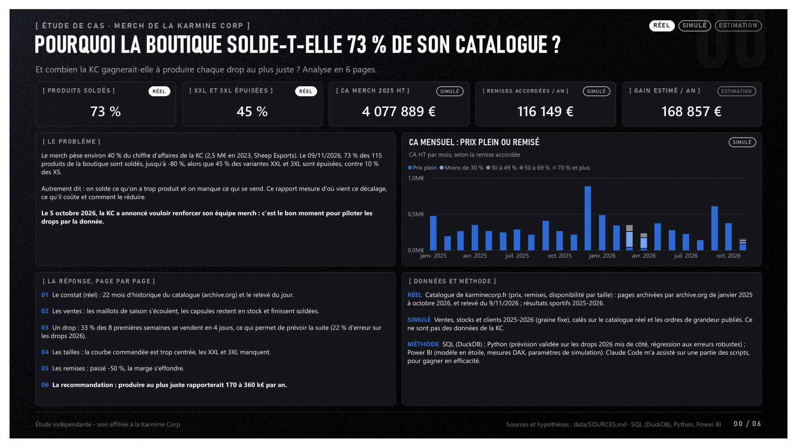
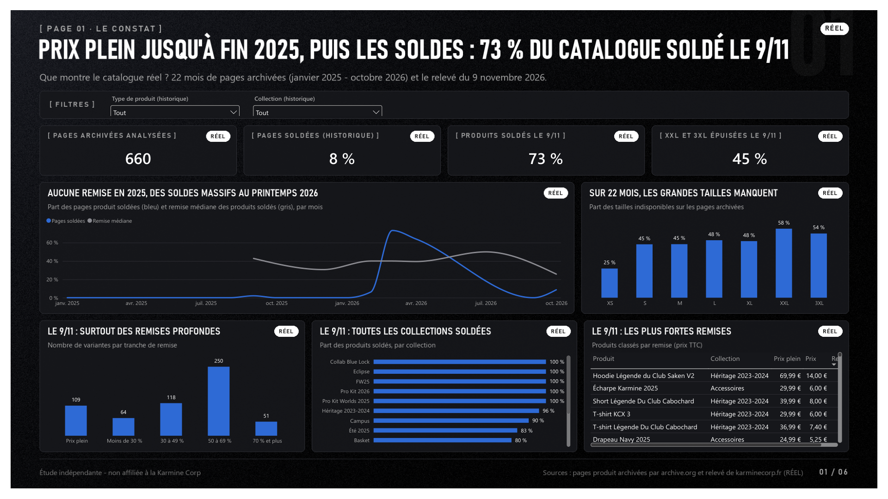
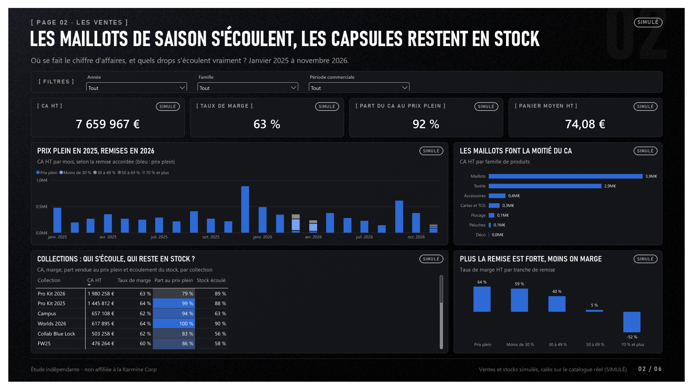
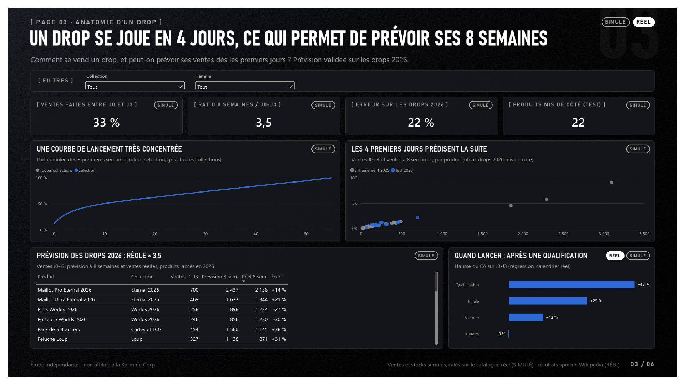
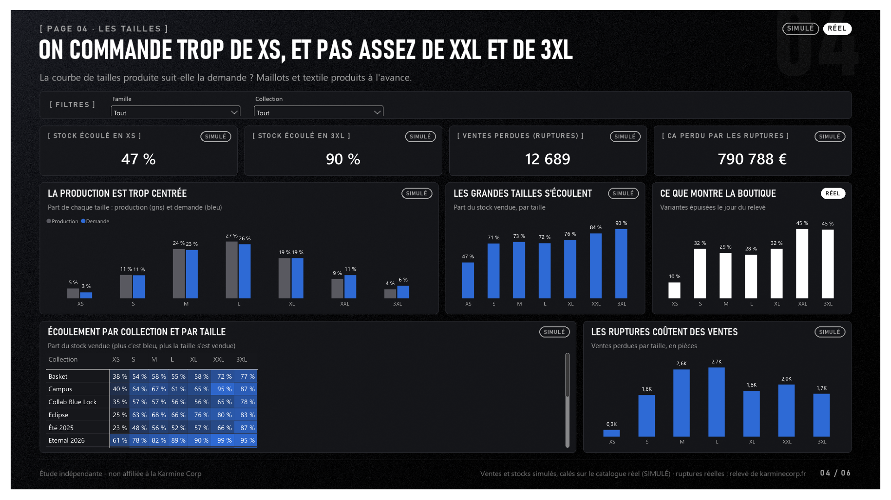
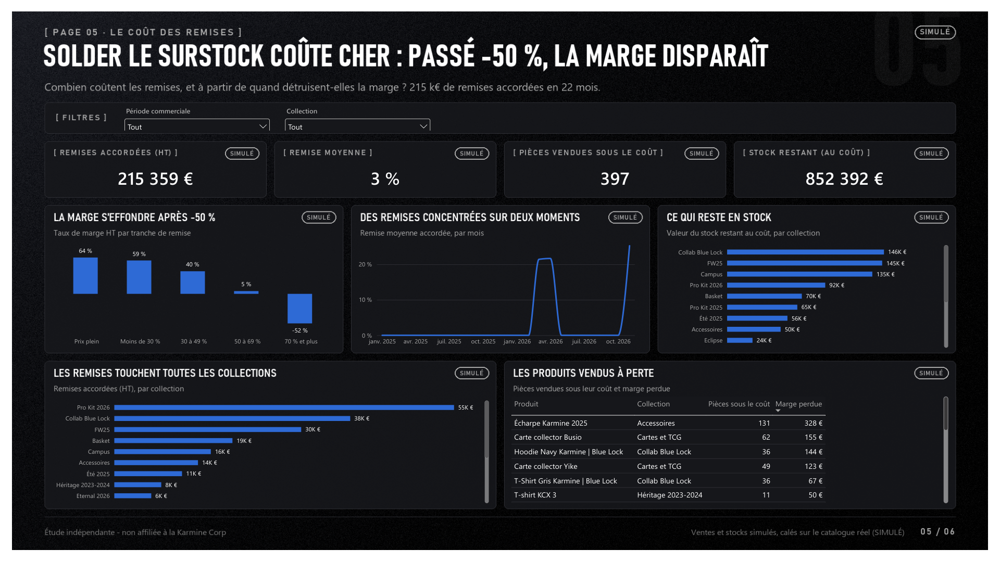
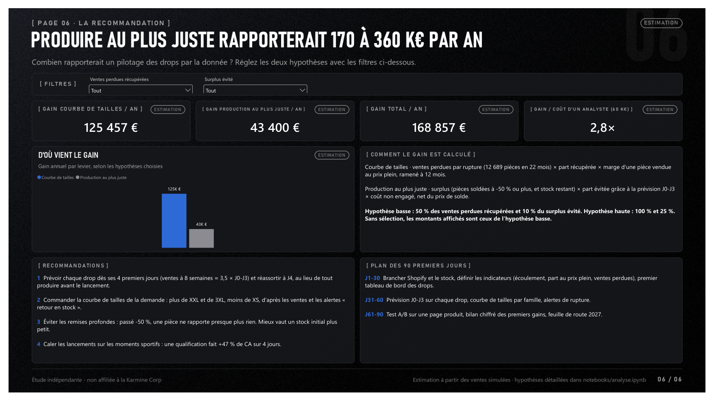

# La data derrière la Blue Wall : le merch de la Karmine Corp

Étude de cas indépendante, réalisée pour une candidature spontanée de data analyst à la Karmine Corp.
**Non affiliée à la Karmine Corp.** Les données du catalogue et les résultats sportifs sont **réels et publics**. Les ventes, les stocks et les clients sont **simulés, et signalés comme tels** sur chaque page : aucune donnée interne du club n'est publique.

## La question
> **Pourquoi la boutique de la KC solde-t-elle 73 % de son catalogue pendant que les grandes tailles sont en rupture, et combien gagnerait-elle à produire chaque drop au plus juste ?**

Le merch pèse environ 40 % du chiffre d'affaires du club : 2,5 M€ sur 7 M€ en 2023, d'après Sheep Esports. Le 9 novembre 2026, le catalogue public de karminecorp.fr montre deux symptômes à la fois :
- trop de stock sur certains produits : 73 % des produits sont soldés, avec une remise médiane de -60 %, alors que la boutique vendait encore tout au prix plein en 2025 ;
- pas assez sur d'autres : 45 % des variantes XXL et 3XL sont épuisées, contre 10 % des XS.

## Les réponses

| # | Sous-question | Données | Réponse |
|---|---|---|---|
| 1 | Que montre le catalogue réel ? | 660 pages produit archivées par archive.org (janv. 2025 - oct. 2026) et relevé du 09/11/2026 (RÉEL) | Jusqu'à fin 2025, la boutique vendait au prix plein (0 % de pages soldées). Les soldes arrivent au printemps 2026 (73 % des pages en mars), et le 9/11, 73 % des produits sont soldés, la plupart à -50 % ou plus. Sur 22 mois, 58 % des XXL et 54 % des 3XL sont indisponibles, contre 25 % des XS. |
| 2 | Où se fait le CA, et quels drops s'écoulent ? | Ventes simulées 2025-2026 | Les maillots font la moitié du CA et les maillots de saison écoulent 88 à 90 % de leur stock. Les capsules (Blue Lock, FW25, Basket, Campus) n'en écoulent que 56 à 63 % : c'est ce surstock qui finit soldé. |
| 3 | Peut-on prévoir un drop dès ses premiers jours ? | Ventes simulées, calendrier sportif réel | Oui. 33 % des ventes des 8 premières semaines se font entre J0 et J3. La règle « 8 semaines ≈ 3,5 × J0-J3 » fait 22 % d'erreur sur les produits 2026 mis de côté, mieux qu'une régression log-log (28 %). Une qualification fait +47 % de CA sur 4 jours (p = 0,001). |
| 4 | La courbe de tailles suit-elle la demande ? | Ventes simulées, ruptures réelles | Non. 47 % du stock XS est écoulé, contre 90 % du 3XL. Les ruptures font perdre environ 12 700 pièces en 22 mois. |
| 5 | Combien coûtent les remises ? | Ventes simulées | 215 k€ de remises accordées, toutes en 2026, et 850 k€ de stock (au coût) qui restent à écouler. La marge passe de 64 % au prix plein à 5 % entre -50 et -69 %, et devient négative au-delà de -70 %. |
| 6 | Combien rapporterait un pilotage par la donnée ? | Estimation | Entre 170 k€ (hypothèse basse) et 360 k€ (hypothèse haute) de marge par an. La valeur s'ajuste en direct dans le rapport avec deux paramètres. |

## Le rapport
Le rapport Power BI compte 7 pages, une sous-question par page. Chaque page a des filtres, des KPI calculés en DAX et des graphiques qui se filtrent entre eux.
Le rapport complet est en PDF : [docs/KarmineCorp_Merch_CaseStudy.pdf](docs/KarmineCorp_Merch_CaseStudy.pdf).



| | |
|---|---|
|  |  |
|  |  |
|  |  |

## Comment c'est construit
```
data/raw/boutique   relevé du catalogue public (JSON + CSV), un par jour depuis le 09/11/2026
data/raw/wayback    historique réel du catalogue : pages produit archivées par archive.org (janvier 2025 - octobre 2026)
data/clean          données réelles mises en forme + données simulées (sim_*.csv)
data/output         sorties des requêtes SQL et du notebook
data/powerbi        schéma en étoile chargé par Power BI
sql/                requêtes DuckDB : courbes de lancement, tailles, remises, RFM, LTV, réachat, étude d'événement
notebooks/          analyse.ipynb : prévision, régression, test A/B, chiffrage des gains
src/                relevé de la boutique, simulateur, préparation Power BI, génération du projet Power BI
powerbi/            projet Power BI (.pbip : modèle en TMDL + rapport en PBIR), thème, fonds de page
docs/               rapport PDF et captures
```

- **Collecte réelle :**
  - l'historique du catalogue (janvier 2025 - octobre 2026) vient des pages produit archivées par archive.org (`src/historique_wayback.py`) ;
  - le catalogue du jour est relevé par une tâche planifiée (`src/snapshot_boutique.py`), à partir de l'endpoint public Shopify ;
  - les résultats sportifs viennent de Wikipedia ;
  - toutes les sources sont dans [data/SOURCES.md](data/SOURCES.md).
- **Simulation :** `src/generate_sim.py` (graine fixe) est calé sur le réel :
  - les vrais produits, prix et tailles ;
  - la remise de chaque produit finit au niveau réellement relevé ;
  - les ruptures simulées concordent avec les ruptures réelles ;
  - le calendrier des remises suit l'historique réel (prix plein en 2025, soldes au printemps 2026, Black Friday 2026) ;
  - le calendrier sportif 2025-2026 crée les pics de ventes.
- **SQL (DuckDB) :**
  - les fonctions de fenêtre servent aux parts cumulées, aux quintiles RFM et aux médianes de référence ;
  - les cohortes sont calculées sans biais de censure : un mois n'est compté que si toute la cohorte a pu l'atteindre.
- **Python :**
  - prévision d'un drop validée sur les produits 2026 mis de côté (règle simple, régression et ratio par groupe comparés) ;
  - effet des moments sportifs estimé par une régression sur 677 jours, avec des erreurs standard robustes (Newey-West) pour démêler les chevauchements ;
  - test A/B avec taille d'échantillon et bootstrap.
- **Power BI :**
  - un schéma en étoile : 5 tables de faits (ventes, stock, relevés réels, historique réel des pages et des tailles) et 5 dimensions (produits, tailles, tranches de remise, calendrier, jours depuis le lancement) ;
  - environ 50 mesures DAX, dont la prévision et son erreur de test calculées dans le modèle ;
  - deux paramètres de simulation pour les gains ;
  - le projet est généré en code (`src/build_pbip.py`).

## Reproduire
```bash
python -m venv .venv
.venv\Scripts\pip install -r requirements.txt
.venv\Scripts\python src\generate_sim.py          # données simulées (graine 2026)
.venv\Scripts\python src\run_sql.py               # requêtes SQL -> data/output
.venv\Scripts\jupyter nbconvert --to notebook --execute --inplace notebooks\analyse.ipynb
.venv\Scripts\python src\historique_wayback.py    # historique réel (archive.org, ~40 min la première fois)
.venv\Scripts\python src\prep_powerbi.py          # schéma en étoile -> data/powerbi
.venv\Scripts\python src\build_pbip.py            # projet Power BI
```
Ouvrir ensuite `powerbi/BlueWall.pbip` dans Power BI Desktop, régler le paramètre `DossierDonnees` sur votre dossier `data\powerbi\`, puis cliquer sur « Actualiser ».
Les titres de Bahnschrift des fonds de page nécessitent Windows.

## Limites
- **Les ventes, les stocks et les clients sont simulés.** Ils démontrent des méthodes, pas la performance réelle du club. Les montants en euros sont des ordres de grandeur.
- **Les ventes perdues sont connues du simulateur, mais pas observables en vrai.** Dans la réalité, on les approcherait avec les alertes « retour en stock » et les ruptures datées, deux données aussi présentes dans le modèle.
- **L'historique du catalogue vient d'archive.org** : les pages produit sont capturées au hasard des passages de ses robots. L'échantillon de produits varie d'un mois à l'autre, donc la page 1 raisonne en parts, pas en volumes.
- **Deux maillots retirés du site** (Pro 2025, Pro 2026 Bleu) sont reconstitués, avec un prix en hypothèse.
